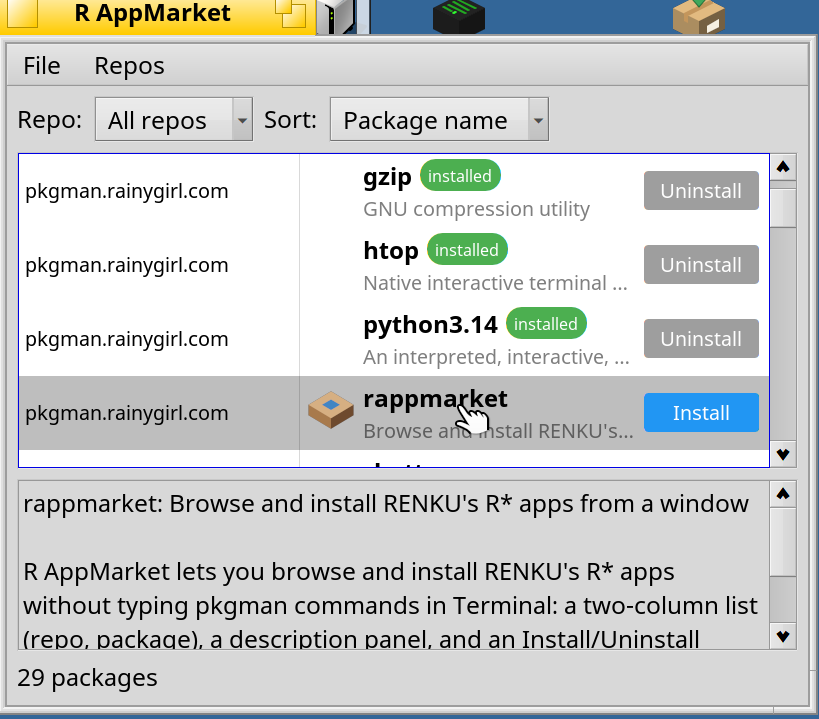

# R AppMarket

[English](README.md) · **한국어** · [日本語](README.ja.md) · [Italiano](README.it.md) · [Français](README.fr.md) · [Español](README.es.md)

R AppMarket은 Terminal에 `pkgman` 명령을 직접 치지 않고도, 창 하나로 등록된 각 저장소의 모든 앱을 찾아보고 설치할 수 있게 해줍니다.



## 설치

**arm64**, **x86_64**, 32비트 **x86**(gcc2 하이브리드)에서 설치할 수 있습니다.

1. **Terminal** 열기: 화면 오른쪽 위 깃털 메뉴를 클릭한 다음 **Applications > Terminal**.
2. 내 아키텍처에 맞는 저장소를 추가한 다음 설치하세요 (헷갈리면 `ls /system/packages/haiku-*.hpkg`로 확인):

   **arm64** 또는 **x86_64**:

   ```sh
   pkgman add-repo https://pkgman.rainygirl.com/arm64    # 또는 .../x86_64
   pkgman refresh
   pkgman install rappmarket
   ```

   32비트 **x86**(gcc2 하이브리드)에서는 패키지 이름이 `rappmarket_x86`입니다:

   ```sh
   pkgman add-repo https://pkgman.rainygirl.com/x86_gcc2
   pkgman refresh
   pkgman install rappmarket_x86
   ```

3. Terminal이 뭔가 물어보면 **y**를 입력하고 **Enter**를 누르세요.
4. 끝나면 데스크탑에 **R AppMarket** 아이콘이 생깁니다. 더블클릭하면 앱을 찾아보고 설치할 수 있습니다.

## 라이선스

MIT.

## AI 활용 고지

이 프로그램은 Claude로 작성되었습니다.
